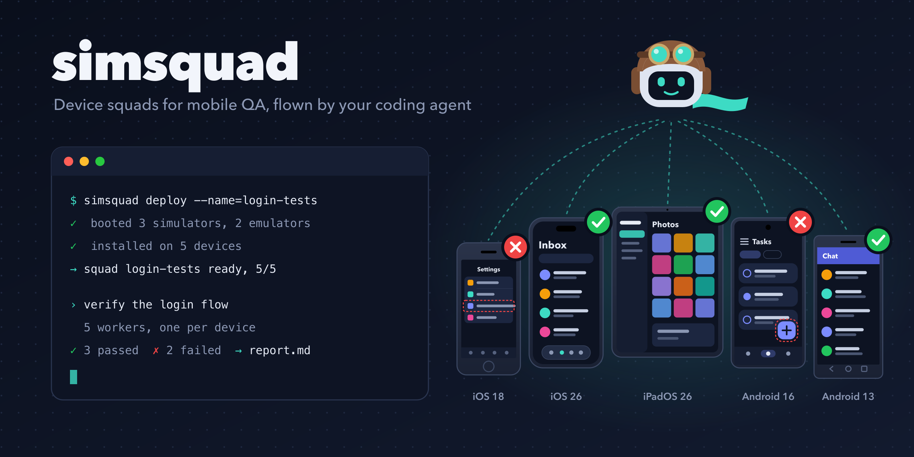

# simsquad



A single-binary device-squad provisioner for parallel mobile QA on macOS.

`simsquad` builds your iOS or Android app, provisions a matrix of simulators
or emulators, installs the build, and emits a machine-readable **squad
descriptor** on stdout. A downstream test driver (an AI agent, a CI job, or a
developer) then drives parallel tests against those devices via
`simsquad devices`.

Deploys are **idempotent by squad name**: re-deploying the same name with the
same matrix reuses the running sims/emulators and just reinstalls the build —
no reboot, no re-provision. That fast reinstall-in-place loop (iterate on a
fix, redeploy, retest) is the real cost-saver, not cold sim creation. A fresh
matrix is created only when the name is new or its devices are gone.

The integration surface is the **CLI itself** — every verb emits JSON on
stdout, human progress on stderr. There are no sidecar files to plumb.

**Agent testing.** simsquad also ships agent skills for Claude Code and
Codex: tell your agent "verify PROJ-123" and it turns the ticket into a
Gherkin feature file, runs one headless worker per simulator or emulator,
and hands back a verdict (passed, failed or infra) with a report and
screenshots. See [docs/agent-testing.md](docs/agent-testing.md).

## Status

Pre-1.0. Go rewrite of the Python `qa-pool` reference tool. macOS only (it
shells out to `xcrun simctl`, `xcodebuild`, `idb`, `adb`, `avdmanager`,
`emulator`). Agent testing is new in 0.4.0; Codex support is experimental.

## Install

```sh
brew install peuf0u/tap/simsquad
# or
go install github.com/peuf0u/simsquad/cmd/simsquad@latest
```

Homebrew also installs [mobilecli](https://github.com/mobile-next/mobilecli)
(from the same tap), which agent testing uses to drive devices. With
`go install` or a source build, install mobilecli 1.0.13 or newer yourself and
put it on `PATH`. Node.js is not required.

From a checkout: `make build` (→ `./bin/simsquad`) or `make install` (→ `$GOBIN`).

## Quickstart

```sh
# Stand up a named squad: one iPhone 17 sim with the app installed.
simsquad deploy --name=login-tests \
  --ios-repo ~/code/myapp-ios \
  --ios-spec 'iPhone 17:iOS 26.4:1' \
  --context user=alice --context api=staging > squad.json
#    stdout is the squad descriptor (redirect it; never use 2>&1).

# Ask for the device list (the qa-run / AI interface).
simsquad devices --name=login-tests --ready

# … run tests against each device's `id` (udid / emulator serial) …

# Tear it down.
simsquad dismiss --name=login-tests
```

### Agent testing quickstart

```sh
cd ~/code/myapp
simsquad equip            # describe the app and devices; accept the skill install
$EDITOR qa/README.md      # app notes: test accounts, navigation, quirks
git add simsquad.toml .agents .claude .codex .gitignore qa && git commit -m "Add simsquad agent testing"
```

Then, in Claude Code or Codex, from the app repo:

> verify that resend is disabled for 30 seconds

The agent drafts a feature file, deploys the project squad, runs a worker
per device and replies with the verdict, the findings and the path of
`report.md` under `.simsquad/runs/`. How it works, feature files, app notes
and verdicts: [docs/agent-testing.md](docs/agent-testing.md).

## Concepts

- **A squad is a named test context = context × device matrix.** Each squad
  has a name (its sole identifier), an optional free-form `context` blob
  (persona, test-account login, API endpoint, feature flags — whatever your
  tests need; not environment variables), and a set of
  provisioned devices. Keep several squads around (`alice-staging`,
  `bob-staging`, `alice-prod`) to run different personas/environments in
  parallel.

- **Secrets stay out of output.** A context key from `[secrets]` (or
  `deploy --secret`, `set-context --set-secret`), or any key whose name
  contains `password`, `secret` or `token`, is a secret: every command
  prints it as `"<secret>"`, its `--out` file too, and so does the test
  report. Only `simsquad devices --name X --reveal` prints the real value
  (refused without `--name` and with `--out`), for the worker that types
  it into the app. The squad record under `~/.cache/simsquad/` keeps the
  real value and is readable by you alone (`0600`).

- **Naming discipline = isolation.** simsquad doesn't have lease primitives.
  Pick a unique name per consumer — `agent-{session_id}`, `ci-pr-{num}`,
  `dev-{user}` — and nothing else will touch your squad.

- **stdout = JSON contract, stderr = human progress.** Always redirect stdout
  only (`> squad.json`). Using `2>&1` mixes progress events into the JSON and
  breaks parsers.

- **`--out <file>` writes the JSON to a file too.** Every command accepts
  it; stdout is unchanged. The file is created or truncated (parent
  folders are created), written whenever the command emits JSON (including
  a non-zero exit such as deploy's `2`), and removed when the command fails
  before emitting any. Agent harnesses that gate shell redirection behind
  an approval prompt (Claude Code) need it: the bundled skills use
  `--out` instead of `>`.

## Verbs

| Command | Action | Key flags |
|---|---|---|
| `deploy` | Build + install; reuse the squad if it exists (same name+matrix), else provision fresh; emit the descriptor | `--name` (req), `--platform ios\|android`, `--device-set NAME`, `--ios-repo`/`--android-repo`, `--ios-spec`/`--android-spec`, `--context KEY=VALUE`, `--secret KEY=VALUE`, `--no-build`, `--force-build`, `--preserve-data`, `--window`, `--clear-context` |
| `status` | Squad registry (no arg) or one full record (`--name`) | `--name` |
| `devices` | Uniform device list — one squad (`--name`) or all (no arg) | `--name`, `--ready`, `--platform=ios\|android`, `--reveal` (real secret values; needs `--name`, no `--out`) |
| `set-context` | Mutate a squad's context | `--name` (req), `--set KEY=VALUE`, `--set-secret KEY=VALUE`, `--unset KEY`, `--clear` |
| `reset` | Return apps to a clean state (terminate + wipe data) without re-provisioning | `--name` (req), `--device` (repeatable) |
| `dismiss` | Tear down a squad (shutdown + delete its sims/AVDs) | `--name` (req) |
| `sweep` | Dismiss squads whose repo path is gone (removed worktrees), then prune orphan `simsquad-*` sims/AVDs left by crashed deploys | — |
| `equip` | Interactive wizard: write `simsquad.toml` / `.local.toml` | `--show`, `--force`, `--add-ios-spec`, `--add-android-spec`, `--device-set NAME` |

Spec formats (repeatable):

```
--ios-spec     DEVICE:RUNTIME:COUNT          e.g. 'iPhone 17:iOS 26.4:1'
--android-spec DEVICE:IMAGE:COUNT[:TARGET]   e.g. 'pixel_7:system-images;android-34;google_apis;arm64-v8a:1'
```

Passing **any** spec flag replaces the TOML matrix entirely for **both**
platforms — omit a platform's flag to skip it for this run. With no spec
flags, both `[[ios.sims]]` and `[[android.sims]]` from `simsquad.toml` are
used.

`deploy --platform ios|android` (repeatable) deploys only those equipped
platforms; the squad's other platform keeps its devices untouched. Reuse is
decided per platform, so a later bare deploy adds the missing platform. It
can't be combined with spec flags.

`deploy --device-set NAME` deploys a named device set instead of the default
matrix: `[device_sets.NAME]` in the config (see
[Configuration](#configuration)), for both platforms, the way spec flags
replace the matrix; `--platform` filters it. The squad records the set's
name (`device_set` in `deploy` / `status` output), so a later
`deploy --name X` with no matrix flags deploys that set again, re-read from
the config, and reuses the squad when its devices still match. A squad with
no recorded set keeps using the default matrix. Combining `--device-set`
with a spec flag, an unknown set, or a recorded set the config no longer
defines exits `1`. A different `--device-set` on an existing squad follows
the usual per-platform reuse rule. Spec flags record no set.

`deploy --window` shows the devices, for a squad used by hand (the
`simsquad` skill's dev squad always passes it; test squads never do).
Android emulators boot with a window and `hw.keyboard=yes`, so the Mac
keyboard types into the app, and a running headless emulator is restarted
with a window, keeping its data. A deploy without `--window` leaves a
running windowed emulator alone and boots new emulators headless. On iOS it
opens Simulator.app on each device, which also shows windows for every
other booted sim.

`deploy` exit codes: `0` = all devices ready · `2` = mixed (some ready, some
errored) · `1` = none ready / bad args / build failed. Only the deployed
platforms' devices count, and a platform whose build failed counts as not
ready; stdout is still the whole squad.

## Agent skills

The `skill` group installs the agent skills embedded in the binary into an
app repo, so the team commits them and every clone gets them. Two skills
ship: **simsquad** (everyday CLI use) and **simsquad-test** (verifying a
feature on a squad).

| Command | Action | Key flags |
|---|---|---|
| `skill install` | Write both skills into the app repo; emit `{dir, version, contract, files}` | `--dir`, `--force` |
| `skill status` | Check the installed skills and `mobilecli` fit this binary | `--dir` |

Run it from the app repo. The skills go beside the config: in the **config
dir**, the nearest folder up from where you run it that holds
`simsquad.toml` (or `simsquad.local.toml`), the same folder `run new` puts
its runs under (see [Project layouts](#project-layouts)). Without config,
install refuses: run `simsquad equip` first. A config dir outside a git
work tree gets a warning on stderr, since nothing there is shared:

```sh
simsquad skill install > skill-install.json
```

It writes:

- `.agents/skills/simsquad/` and `.agents/skills/simsquad-test/` (Codex
  discovers them here), with `.claude/skills/<skill>` links for Claude Code.
  `--dir <dir>` writes the skills there instead, for other agent tools, and
  makes no `.claude/skills` links.
- `.claude/settings.json`: allows `mobilecli`, `simsquad reset`,
  `simsquad run validate` and writes under `.simsquad/runs/`, so headless
  workers never wait on a prompt. Existing
  settings are kept; the entries are merged in.
- `.codex/rules/simsquad.rules`: the same command allowances for Codex.
- A `.simsquad/` line in `.gitignore`, added once.
- `qa/README.md`, a scaffold for the **app notes** every worker reads
  (navigation tricks, test accounts, known quirks), only when the file is
  missing. Install never overwrites it, not even with `--force`.

**Codex (experimental).** Deploys write outside the repo
(`~/.cache/simsquad/`, `~/Library/Developer/`, the Android SDK, `~/.gradle`)
and talk to the simulator services, and workers reset apps and reach
mobilecli's on-device agent. Codex's default `workspace-write` sandbox
blocks that, so run test runs from a session started with
`codex --sandbox danger-full-access` (or `sandbox_mode =
"danger-full-access"` in `~/.codex/config.toml`); the simsquad-test skill
starts its workers with `codex exec --sandbox danger-full-access`.

Every generated file starts with a do-not-edit header carrying the binary
version and the **skill contract** number, which changes only when the
interface between the skills and the CLI changes. Put project knowledge in
`qa/README.md`, not in the skill files: install refuses to overwrite a skill
file that was edited by hand unless `--force` is given. Re-running install
is safe.

`skill status` tells you, and the simsquad-test skill's first step, whether
the installed skills and the device driver fit this binary:

```sh
simsquad skill status > skill-status.json
```

```json
{
  "installed": true,
  "skill_contract": 2,
  "binary_contract": 2,
  "in_sync": true,
  "mobilecli": { "found": true, "version": "1.0.13", "minimum": "1.0.13", "meets_minimum": true }
}
```

- Same skill contract as the binary: `in_sync: true`, exit `0`.
- Older skills, or none installed: exit `0` with a `warning` telling you to
  re-run `simsquad skill install`. No config: exit `0`, not installed, with
  a `warning` to run `simsquad equip` first.
- Newer skills: exit `1`, so a skill never calls commands this simsquad
  doesn't have. Upgrade simsquad.
- `mobilecli` is looked up on `PATH` and its version compared with the
  minimum simsquad was tested with (1.0.13). If you installed simsquad with
  `go install`, install that mobilecli version or newer yourself.

## Test runs

The `run` group holds the deterministic steps the simsquad-test skill calls
while verifying a feature on a squad. Like every verb, each emits JSON on
stdout and human progress on stderr.

| Command | Action | Key flags |
|---|---|---|
| `run new` | Start a test run from a Gherkin feature file; emit the run descriptor | `<feature-file>`, `--fresh`, `--worker`, `--model` |
| `run worker` | Run one headless worker under a hard deadline; emit `{status}` | `--dir` (req), `--timeout` seconds (req), `-- <command…>` |
| `run validate` | Check a worker's `result.json`; emit `{valid, errors}` | `<worker-dir>` |
| `run report` | Write `report.json` + `report.md`; emit `{verdict, report_json, report_md, counts}`; exit 0/1/2 | `<run-dir>` |

### `run new` — start a test run

`simsquad run new <feature-file> [--fresh] [--worker claude|codex]
[--model <id>]`, run from the app repo, reads a Gherkin feature file and
sets up a test run:

```sh
simsquad run new qa/features/login.feature > run-new.json
# {"run_id", "run_dir", "squad_name", "fresh", "platforms", "deadline_seconds", "worker", "worker_model", "app_notes"?}
```

- Background steps are prepended to every scenario, Scenario Outlines expand
  to one scenario per Examples row, and tags are inherited from the feature.
  `@ios` / `@android` restrict platforms, `@explore` marks the exploration
  (its description is the charter). Other tags are kept and ignored. The
  description's `Source:` line is recorded.
- Squad: `qa-<repo>` (the folder holding `simsquad.toml`), or
  `[agent].test_squad`; `--fresh` adds a unique suffix for an isolated squad.
- Platforms: the equipped platforms the tags allow. A tag naming an
  unequipped platform, malformed Gherkin, or a squad in use by a run that
  shares a platform and has no `report.json` yet is refused before anything
  is written.
- Deadline per worker: `120 + Σ(60 + 30 × steps)` over the scenarios of the
  busiest platform, `+ 600` when it has an exploration.
- Worker model, never empty: `--model`, else `[agent].worker_model`
  (`simsquad.local.toml` over `simsquad.toml`), else the default for
  `--worker` (default `claude`): `sonnet` for `claude`, `gpt-6.1-sol` for
  `codex`. Any other `--worker` exits `1`. The ids are passed on as given,
  never validated. `worker_model` is one value for both CLIs: set it only
  when it suits every CLI the team uses, or pass `--model` per run.
- Creates `.simsquad/runs/<run-id>/` in the config dir with
  `feature.feature` (a copy) and `run.json` (title, source, squad,
  platforms, deadline, worker and worker model, `app_notes` and the
  expanded scenarios).
- `app_notes` is the absolute path of `qa/README.md` in the config dir, so
  workers read the app notes without guessing which repo holds them. It is
  omitted, in `run.json` and on stdout, when that file doesn't exist.
- `run_dir` and `app_notes` have every symlink resolved, even when you
  reached the repo through one: a Claude Code worker's permission rules
  must match the path a file really lives at.

### `run worker` — run a headless worker

```sh
simsquad run worker --dir .simsquad/runs/<run-id>/workers/<device-id> \
  --timeout 720 --out worker.json \
  -- claude -p "Read prompt.md and follow it." --allowedTools "Bash(mobilecli:*)"
```

`run worker` starts the command in its own process group with its input
closed (so `codex exec` can't wait for input forever) and sends the
command's output to `<dir>/worker.log`. The outcome:

| Worker | `<dir>/status` | stdout `status` |
|---|---|---|
| exits 0 in time, `<dir>/result.json` exists | not written | `ok` |
| exits non-zero, or exits 0 without `<dir>/result.json`, and the end of `worker.log` holds a known Claude Code or Codex usage-limit message | `error: usage limit` | same |
| exits 0 in time, no `<dir>/result.json` | `error: no result.json` | same |
| exits non-zero otherwise | `error: worker exited <code>` | same |
| still running at `--timeout` | `blocked: timeout` — the whole group, children included, is killed | same |

A worker killed by a signal reports the negative signal number as its
code (e.g. `-9`). Only these fixed texts are recorded, never lines from
the log, which can hold credentials from the squad's context. When `--dir`
sits in a run folder (`<run>/workers/<id>`), the squad named by
`<run>/run.json` has its secret values replaced by `<secret>` in
`worker.log` as it is written, raw or JSON-escaped: a Codex worker's
output repeats the commands it ran and their output, `devices --reveal`
included. A value secret only by its key's name is redacted there from 4
characters on and never as `true`/`false`, so `TOKEN_TTL=5` doesn't mask
every `5`.

Running `run worker` again on the same `--dir` is a retry. Before the
worker starts, the earlier attempt's outputs (everything except
`prompt.md` and `attempts/`: `result.json`, `log.md`, `screenshots/`,
`worker.log`, `status`, …) move to `<dir>/attempts/<n>/`, numbered from 1.
A moved folder is recreated empty, so `screenshots/` is still there for the
retry. A stale result or status is never read as the retry's: `run
validate` and `run report` ignore `attempts/`. simsquad never retries a
worker on its own. `run worker` exits `0` whenever it recorded an outcome, so
one bad worker doesn't derail a fan-out; it exits `1` only on misuse (no
command, bad flags, unwritable dir).

### `run validate` — check a worker's result

`simsquad run validate <worker-dir>` validates `<worker-dir>/result.json`
against the embedded result schema plus the evidence rule, and prints
`{"valid", "errors"}`. It exits `1` when the result is invalid.

### `run report` — verdict and reports

```sh
simsquad deploy --name qa-app > .simsquad/runs/<run-id>/deploy.json
# … one `run worker` per ready device into workers/<device-id>/ …
simsquad run report .simsquad/runs/<run-id> > report-summary.json
# {"verdict", "report_json", "report_md", "counts"}
```

`run report <run-dir>` reads `run.json`, `deploy.json` (the deploy output,
source of the device rows and context) and each ready device's
`workers/<device-id>/` (`result.json`, `status`). It writes:

- `report.json`, valid against the embedded report schema: feature title,
  source, squad and context, a scenario × device matrix
  (`passed` / `failed` / `blocked` / `skipped` per device), each device's
  worker status, scenarios and findings, and the counts. Paths are relative
  to the run dir.
- `report.md`, pasteable into a PR: verdict, source link, context keys and
  values (secrets as `<secret>`), the matrix, bugs by severity, per-device
  results.

A status file overrides even a valid result; a missing or invalid
`result.json` marks the worker `error` and is recorded with its
validation errors. A scenario a worker didn't report counts as blocked.

| Verdict | Exit | When |
|---|---|---|
| `passed` | `0` | every scenario passed on every device, zero bugs, every device deployed |
| `failed` | `1` | a failed or blocked scenario, a bug, or a blocked/errored worker |
| `infra` | `2` | `deploy.json` missing or unparseable, no ready device, no worker results, every worker blocked/errored, or a device deploy couldn't get ready while the others found nothing wrong |

Writing `report.json` marks the run finished, freeing its squad for the
next `run new`. A missing or unparseable `run.json` exits `2` without
writing a report.

## Configuration

simsquad reads two optional TOML files from the nearest ancestor directory
containing either:

- `simsquad.toml` — team defaults, checked into git.
- `simsquad.local.toml` — per-developer overrides, gitignored.

Run `simsquad equip` for an interactive setup wizard, or copy
[`simsquad.toml.example`](simsquad.toml.example) and edit. See that file for the
full annotated schema (`[project]`, `[context]`, `[secrets]`, `[agent]`,
`[[ios.sims]]`, `[[android.sims]]`, `[device_sets.<name>]`).

**Secrets.** Test-account passwords and tokens go in `[secrets]` in
`simsquad.local.toml`:

```toml
[secrets]
password = "hunter2"
```

Its keys join the squad context as secrets, shown as `"<secret>"` in every
output (see Concepts). `[secrets]` and `[context]` are separate sources:
`deploy --secret KEY=VALUE` replaces `[secrets]` and leaves `[context]`
alone, `--context` leaves `[secrets]` alone, and a key in both is an
error. A context key named like `password`, `secret` or `token` is a secret
even in `[context]`. `[secrets]` in `simsquad.toml` works, but deploy warns
that it is committed; `equip` saves secrets to `simsquad.local.toml`,
which it writes `0600`.

**Device sets.** Besides the default matrix, the equipment can hold named
device matrices, deployed with `deploy --device-set NAME`:

```toml
[[device_sets.tablet.ios.sims]]
device  = "iPad Pro 13-inch (M5)"
runtime = "iOS 26.4"
count   = 1

[[device_sets.tablet.android.sims]]
device = "pixel_tablet"
image  = "system-images;android-34;google_apis;arm64-v8a"
count  = 1
```

Rows are shaped like `[[ios.sims]]` / `[[android.sims]]`. A set is only a
device matrix: the repos, scheme and Gradle task stay in `[project]`. A set
in `simsquad.local.toml` replaces the `simsquad.toml` set of the same name
wholesale (its rows don't merge). In `simsquad equip`, the editor's **Device
sets** group creates, renames, deletes and edits sets with the same pickers
as the default matrix; `equip --add-ios-spec … --device-set NAME` appends to
a set (creating it in `simsquad.toml`), and `equip --show` lists the sets.
equip keeps each set in the file it came from.

**Precedence**, highest to lowest:

```
CLI flag  >  env var  >  simsquad.local.toml  >  simsquad.toml  >  built-in default
```

Environment variables: `SIMSQUAD_IOS_REPO`, `SIMSQUAD_ANDROID_REPO`,
`SIMSQUAD_CACHE_DIR` (cache root; defaults to `~/.cache/simsquad`).

### Android: APK or app bundle

`[project].android_gradle_task` decides how the app is installed. Its
project path names the module whose output simsquad picks up
(`:mobile:assembleDebug` → the newest APK under `mobile/build/outputs/apk`;
a task without one, like `assembleDebug`, means `app`).

- **`assemble*`** (the default `:app:assembleDebug`) builds one APK,
  installed with `adb install`.
- **`bundle*`** (`:app:bundleDevDebug`) builds an app bundle. simsquad takes
  the newest one in the task's variant folder (`app/build/outputs/bundle/devDebug`;
  a bare `bundleDebug` on a flavored app has no such folder, so name the
  variant), turns it into an APK set once per deploy (`bundletool build-apks
  --local-testing`) and installs that on every device with `bundletool
  install-apks`. Use it for an app with dynamic feature modules: an
  assemble build installs only the base APK, so feature screens fail to
  open, and deploy warns about it. `--local-testing` lets on-demand
  modules install without Google Play. bundletool merges install-time
  modules not marked `dist:removable` into the base APK, so `pm path` can
  list only the base and its config splits while the features are there.
  Data is cleared before the install, not after: `pm clear` also deletes
  the on-demand splits `install-apks` leaves in external storage. For the
  same reason `reset` installs the squad's APK set again after clearing.
  It skips that, with a warning, when the file is gone (a `gradle clean`)
  or is newer than the squad's deploy (another squad deployed from the
  same repo since); on-demand modules then can't install until the next
  deploy.

A bundle task needs [bundletool](https://developer.android.com/tools/bundletool),
which simsquad doesn't install: `brew install bundletool` (it runs on the
Java that Gradle already needs). bundletool signs the APK set with the
default debug keystore, `~/.android/debug.keystore` (alias
`androiddebugkey`, password `android`). Gradle signs debug builds with
that same keystore unless the project sets its own debug `signingConfig`.
If it does, the bundle-installed app carries a different signature than
a Gradle-installed one: installing one over the other fails on the
signature, which a deploy without `--preserve-data` gets past by
uninstalling and retrying once (the app's data goes with it), and
anything tied to the project's debug certificate (a Google sign-in or Maps API key registered for its SHA-1) won't accept the
bundle-installed app. Register the default keystore's SHA-1 too where that
matters. When `~/.android/debug.keystore` doesn't exist (Gradle creates
it only for a project on the default debug signing), the deploy fails
and prints the `keytool` command that creates it.

## Project layouts

simsquad has one root for everything it shares: the **config dir**, the
folder holding `simsquad.toml`. `skill install` writes the skills there,
`run new` puts run folders under its `.simsquad/runs/`, and workers read
the app notes from its `qa/README.md`. Commit the config dir so colleagues
get the config, skills, app notes and saved feature files when they clone;
`equip` (when it creates the config) and `skill install` warn when it isn't
inside a git work tree.

| | Single repo | Umbrella workspace repo | Split repos (home repo) |
|---|---|---|---|
| Config (`simsquad.toml`) | the repo root, or the app's subfolder (`mobile/`) | the umbrella folder | the home repo |
| Skills (`.agents/`, `.claude/`, `.codex/`) | beside the config | the umbrella folder | the home repo |
| App notes and feature files (`qa/`) | beside the config | the umbrella folder | the home repo |
| Run folders (`.simsquad/runs/`, gitignored) | beside the config | the umbrella folder | the home repo |
| App repo paths | `ios_repo = "."` (or a relative path) in `simsquad.toml` | relative paths (`ios`, `android`) in `simsquad.toml` | `"."` for the home repo in `simsquad.toml`; the other repo's path in `simsquad.local.toml` |

- **Single repo.** iOS and Android (or one of them) live in one repo.
  Everything sits in the config dir: the repo root, or the subfolder that
  holds the mobile apps in a monorepo. Run simsquad from that folder or
  below it.
- **Umbrella workspace repo.** The apps live in separate repos checked out
  side by side in one folder (`myapp/ios/`, `myapp/android/`). Make the
  umbrella folder a small workspace repo of its own (`git init` there) and
  list the app repo folders in its `.gitignore`, so it tracks only the
  config, skills and `qa/`. Run simsquad from the umbrella folder.
- **Split repos with no shared parent.** The apps live in separate repos
  checked out wherever each developer likes. Pick one app repo as the
  **home repo** and run `simsquad equip` there: the config, skills and `qa/`
  live in it, and each developer points at their checkout of the other
  repo with an absolute path in `simsquad.local.toml`. Run simsquad from
  the home repo.

## State

simsquad keeps a per-user registry and per-squad records under
`~/.cache/simsquad/`:

- `squads.json` — the registry, keyed by squad name.
- `<name>.json` — one record per squad.
- `derived/` — xcodebuild derived-data + build logs (the expensive build cache).

To wipe squad state without losing the build cache, remove the JSON files but
keep `derived/`.

## Known limitations

- **macOS only.** Relies on Xcode / Android SDK command-line tools.
- **Older `avdmanager` rejects dotted API levels.** Outdated Android
  command-line tools reject system images like `android-36.1` (any `.N`
  suffix). Update them, or install a plain level (e.g. `android-34`) via
  `sdkmanager`. simsquad pre-flights a warning.
- **Never `2>&1`.** It merges stderr progress into the stdout JSON contract.
  Redirect stdout only (`simsquad deploy … > squad.json`), or use
  `--out squad.json`.
- **Android build output is looked for under `<module>/build/`.** A
  custom `buildDir` or `projectDir` in the Gradle settings isn't followed.
- **Physical Android devices** are claimed by adb serial; simsquad never
  deletes a physical device, only uninstalls the app on teardown.

## Documentation

- [`docs/agent-testing.md`](docs/agent-testing.md) — agent testing: project
  setup, running a test, what the orchestrator and workers do, feature
  files, verdicts, app notes, Codex.
- [`docs/integrations/consumer.md`](docs/integrations/consumer.md) — how a test
  driver (qa-run / AI agent / CI) consumes a squad: the deploy → devices →
  dismiss lifecycle, JSON shapes, and the naming convention for isolation.
- [`GLOSSARY.md`](GLOSSARY.md) — the project's vocabulary (squad, equipment,
  test run, worker, verdict, …).
- [`docs/adr/`](docs/adr/) — architecture decisions.
- [`CHANGELOG.md`](CHANGELOG.md) — release notes.
- `CLAUDE.md` — contributor/contract reference (locked decisions, landmines).

## License

MIT — see [`LICENSE`](LICENSE).
